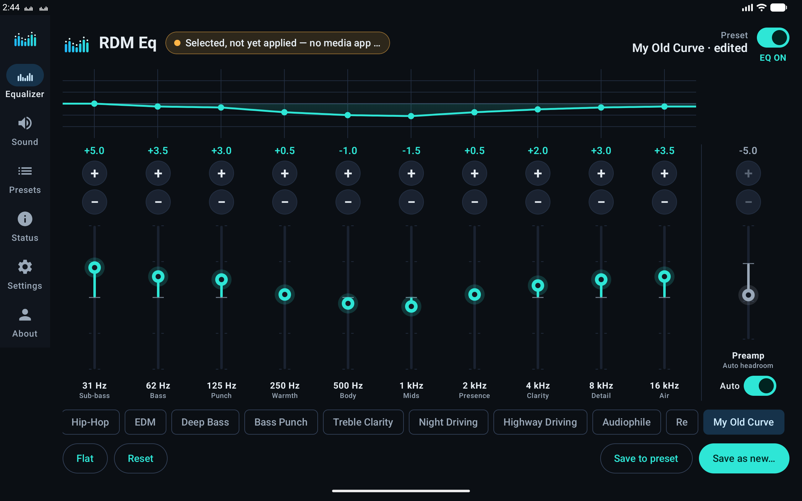
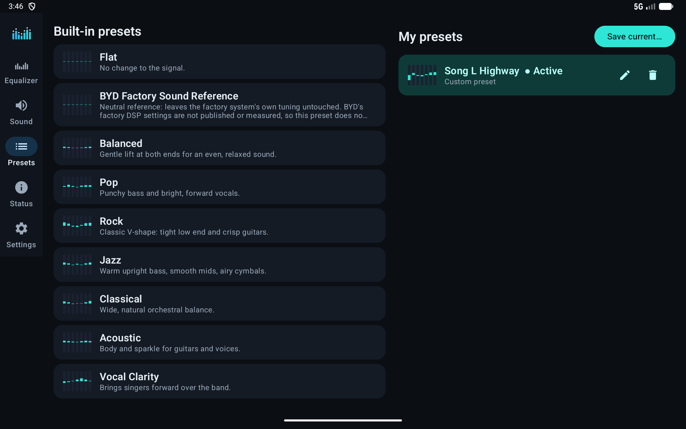
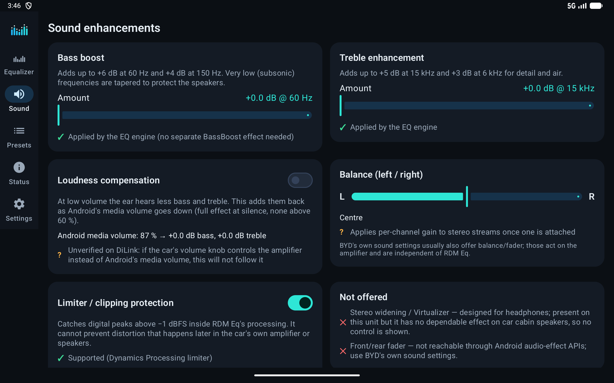
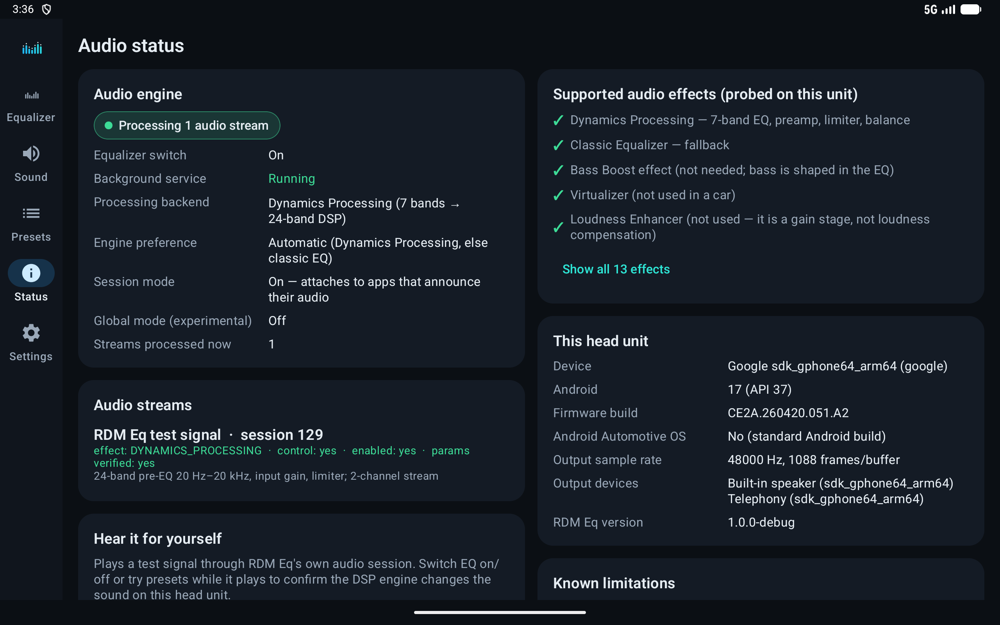
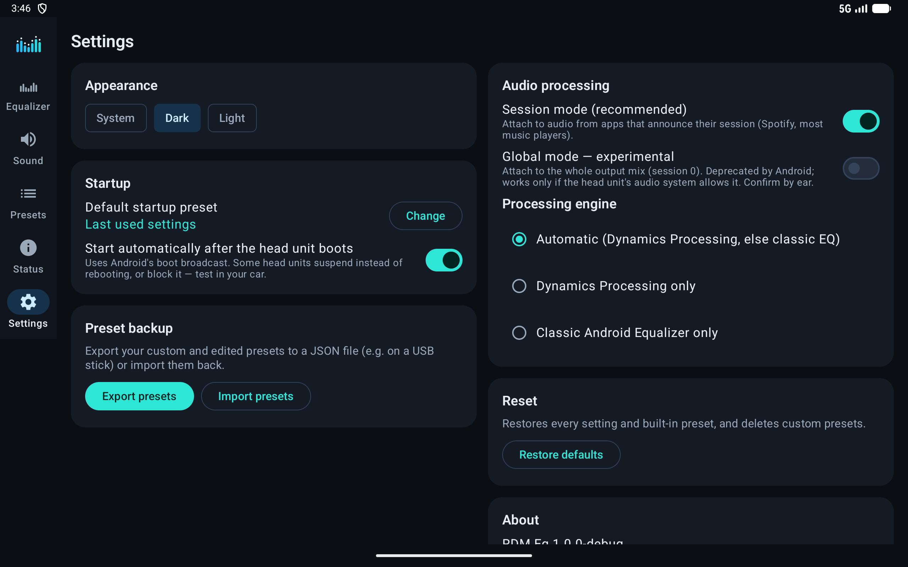

# RDM Eq — 10-band equalizer for BYD DiLink 5

RDM Eq is an Android equalizer built for the BYD Song L EV head unit (DiLink 5). It processes real audio
through Android's own audio-effect engine. It works on **audio from other apps** whenever that app
tells Android which audio session it is playing on. Spotify and most music players do this.



> **Read [COMPATIBILITY_REPORT.md](COMPATIBILITY_REPORT.md) before installing.** It explains what works,
> what was tested, what cannot be tested without the car, and a 20-minute test plan for the vehicle.

## Files

| File | What it is |
|---|---|
| `../Deliverables/RDM-Eq-1.0.0-release.apk` | **Install this in the car.** Signed release build, 2.2 MB. |
| `../Deliverables/RDM-Eq-1.0.0-debug.apk` | Debug build (separate app id `com.rdm.eq.debug`, has an adb test hook). For testing only. |
| `../Deliverables/RDM-Test-Player-diagnostic.apk` | Optional: a tiny "media app" that plays noise and announces its session, to prove cross-app processing on any unit. |
| `app/` | RDM Eq source (Kotlin, Jetpack Compose). |
| `testplayer/` | Source of the diagnostic test player. |
| `keystore/rdm-eq-release.jks` + `keystore.properties` | Release signing key. **Back these up**: see "Signing" below. |

## Features

- **Ten bands** at 31, 62, 125, 250, 500 Hz, 1, 2, 4, 8 and 16 kHz, from −12 to +12 dB in 0.5 dB steps.
  Each band has **+ / −** buttons above a slim fader. Drag the fader for quick moves, or double-tap it to reset to 0.
  The engine turns the 10 points into a smooth 31-band curve (log-frequency interpolation).
  Curves and presets saved by 1.0/1.1 (7 bands) are converted automatically when you update.
- **Live frequency-response graph** of what is actually applied (bands + bass/treble/loudness + preamp).
- **Preamp** (−12…+6 dB) with **Auto headroom**, which automatically lowers the level by the largest boost so the EQ never adds clipping.
- **Clipping warning** whenever the settings can push peaks above 0 dB.
- **Limiter** at −1 dBFS (Dynamics Processing engine).
- **Bass boost** (up to +6 dB at 60 Hz, with subsonic protection below 30 Hz) and **treble enhancement** (up to +5 dB at 15 kHz).
- **Loudness compensation** that follows Android's media volume (see limitations).
- **Left/right balance** on stereo streams. It only ever turns one side down.
- **18 built-in presets**: Flat, BYD Factory Sound Reference (neutral; does not imitate BYD's unpublished DSP), Balanced, Pop, Rock, Jazz,
  Classical, Acoustic, Vocal Clarity, Podcast and Speech, Hip-Hop, EDM, Deep Bass, Bass Punch, Treble Clarity, Night Driving,
  Highway Driving, Audiophile.
- Edit any preset, save it back, and **restore** built-ins to their originals. **Custom presets** can be saved, renamed and deleted.
  **Export/import** presets as JSON (e.g. via USB stick).
- **Settings persist** across app restarts and reboots. You can choose a default startup preset or keep the last used one.
- **Automatic start after boot** (optional) with a background service that keeps listening for media apps.
- **Audio Status screen**: backend, every attached audio stream (effect created / has control / enabled / parameters read back / playing),
  effects this unit supports, device and firmware info, permissions, known limitations, and a log you can copy.
- **Built-in test signal** (pink noise or a bass + hi-hat loop) to hear the engine work on the head unit itself.
- Adapts to landscape (car), portrait (rotating screens) and small screens. Dark and light themes are included.
- **In-app updates from GitHub Releases** (1.1.0+): Check for Updates in Settings/About, automatic check (max every 12 h),
  release notes, download progress with resume, SHA-256 + signing-certificate verification, Android's own install
  confirmation. Presets and settings are kept. Optional beta channel.
- **About screen** with developer credit, installed version, build number and update status.
- Works offline. The only network use is reading GitHub Releases for updates over HTTPS: no analytics, ads or accounts.

| Presets | Sound | Status | Settings |
|---|---|---|---|
|  |  |  |  |

## Build

Requirements: JDK 17+ (Android Studio's bundled JBR works) and the Android SDK with platform 35.

```bash
./gradlew :app:testDebugUnitTest      # 41 unit tests
./gradlew :app:assembleDebug          # app/build/outputs/apk/debug/app-debug.apk
./gradlew :app:assembleRelease        # app/build/outputs/apk/release/app-release.apk (needs keystore.properties)
```

You can also open the `RDMEq` folder in Android Studio and press Run.

Toolchain used: Gradle 8.14.3, Android Gradle Plugin 8.13.2, Kotlin 2.2.10, Compose BOM 2025.04.00,
compileSdk/targetSdk 35, **minSdk 28** (Android 9, required for the Dynamics Processing effect; DiLink 5 is Android 13).

## Updates and releases

- Releases: https://github.com/ramyadmin-BYD/RDM-Eq/releases
- How to publish a new version: [RELEASING.md](RELEASING.md) (one command: `scripts/release.sh`).
- Updating from **1.0.0**: install 1.1.0 once by hand (it has no updater yet). It installs over 1.0.0 and keeps presets.
- Android **always asks the user to confirm** an update; apps can't install themselves silently. The first time, Android also asks
  you to allow RDM Eq to "install unknown apps". If a BYD firmware hides that setting, install the APK from the release page via USB instead.

### "Harmful app blocked" (Google Play Protect)
Devices with Google Play services may warn about or block RDM Eq because it is new and can install its own updates.
See [docs/PLAY_PROTECT.md](docs/PLAY_PROTECT.md) for why, what 1.2.0 changed, and a ready-to-paste appeal to Google.

## Signing

The release APK is signed with `keystore/rdm-eq-release.jks`. The passwords are in `keystore.properties`.
**Android only installs an update over an existing app if it is signed with the same key.** Keep both files
in a safe place outside this folder (e.g. a password manager plus a backup drive). If the key is lost,
you must uninstall RDM Eq and reinstall it, which loses your presets unless you exported them first.

To release an update: raise `versionCode` and `versionName` in `app/build.gradle.kts`, then run `./gradlew :app:assembleRelease`.

## Installing on the BYD DiLink 5 head unit

BYD does not officially support installing your own apps. The routes below are reported by owners and vary by firmware.
None of them were verified on a real car for this project.

1. **Park the car.** Copy `RDM-Eq-1.0.0-release.apk` to a FAT32/exFAT USB stick.
2. Plug it into a USB-A data port and open the APK from DiLink's file manager / media browser.
   If DiLink asks, allow that app to install unknown apps.
3. If the file manager won't open APKs, owners report two other routes:
   - downloading the APK in the head unit's browser and opening the download;
   - on some firmware, using a third-party "installer" app or USB-debugging (adb), only where the firmware permits.
   Some DiLink 5.0 builds are reported to block sideloading completely.
4. Open **RDM Eq**, allow notifications (this keeps the engine visible and alive), and on the **Status** tab
   tap **Request** next to battery optimisation if offered.
5. Run the vehicle test plan in [COMPATIBILITY_REPORT.md](COMPATIBILITY_REPORT.md).

A BYD over-the-air update may remove sideloaded apps or reset their permissions. Export your presets (Settings → Export presets) after you set them up.

## Project layout

```
app/src/main/java/com/rdm/eq/
  model/      EqBands, Preset + 18 BuiltInPresets, AudioSettings
  dsp/        CurveMath: interpolation, headroom, clipping, band mapping (pure Kotlin, unit-tested)
  data/       KeyValueStore, PresetRepository (custom/override/export/import), SettingsRepository
  audio/      AudioEngine (session manager), DynamicsProcessingBackend, LegacyEqualizerBackend,
              AudioCapabilities (runtime probe), PlaybackMonitor, TestSignalPlayer
  service/    EqService (foreground), SessionBroadcastReceiver, BootReceiver
  ui/         MainActivity, theme, components (faders, curve), screens/*
  EqController.kt   single source of truth between UI, storage and audio engine
app/src/debug/      adb-only test hook (not in the release APK)
app/src/test/       26 JVM unit tests
testplayer/         diagnostic third-party "media app"
```
